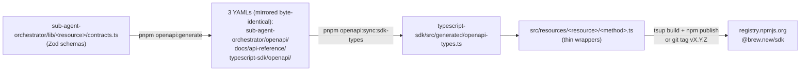

# Releasing `@brew.new/sdk`

The single concise reference for iterating on this SDK and shipping a new
version to npm. Read [`AGENTS.md`](./AGENTS.md) for code conventions and
[`docs/development.md`](./docs/development.md) for the deeper end-to-end
"add a new endpoint" walkthrough.

## Release protection

Configure the `npm-release` GitHub environment with approval and a deployment
rule for release tags. Keep publish credentials in that environment. Protect
`main` and release tags, grant tag creation to the release operators, and
verify the release commit is on `main` before tagging.

## Source of truth



The Zod contracts in `sub-agent-orchestrator/lib/<resource>/contracts.ts`
are the **only** source of truth. Everything downstream is generated.
Never hand-edit `openapi/public-api-v1.yaml` or
`src/generated/openapi-types.ts` — they get overwritten.

## Iterate loop

1. **Make the API change in the app package** (`sub-agent-orchestrator/`):
   - Update or add a Zod schema in `lib/<resource>/contracts.ts`.
   - Update or add the route handler under `app/api/v1/<resource>/route.ts`.
   - Register the operation in `openapi/public-api-v1-<resource>.ts`.
   - Add the app-side test in `tests/api/`.

2. **Mirror the spec to every consumer**, from inside `sub-agent-orchestrator/`:

   ```bash
   pnpm openapi:generate          # writes the YAML to all 3 locations
   pnpm openapi:sync:sdk-types    # regenerates src/generated/openapi-types.ts
   pnpm openapi:check             # CI-style verification that everything is in sync
   ```

3. **Update the SDK** (this package):
   - One file per method under `src/resources/<resource>/<method>.ts`.
   - Wire it into `src/resources/<resource>/resource.ts`.
   - Re-export public types from `src/index.ts`.
   - Add an MSW test under `tests/resources/<resource>/<method>.test.ts`.

4. **Document it** in `docs/<resource>.md` (the resource-level reference)
   and update `RELEASING.md` (this file) only if the workflow itself changes.

## Local validation (run before every commit)

```bash
bun install --frozen-lockfile  # only if package.json or bun.lock changed
bun tsc                        # typecheck (strict, exactOptionalPropertyTypes)
bun lint                       # eslint flat config + typescript-eslint
bun run format                 # prettier write (or `format:check` to verify)
bun run test                   # vitest + MSW. NEVER `bun test` (bypasses MSW)
bun run build                  # tsup -> dist/ esm + cjs + .d.ts + .d.cts
```

CI (`.github/workflows/ci.yml`) runs the same checks plus a
`git diff --exit-code src/generated/openapi-types.ts` guard, so any drift
between `openapi/public-api-v1.yaml` and the generated types fails the
build.

## Release recipe (preferred path: tag-driven)

After [`.github/workflows/release.yml`](./.github/workflows/release.yml)
is wired up with the `NPM_TOKEN` secret (one-time setup, see below),
shipping a new version is just:

```bash
# From a clean main after the iterate loop.
git pull --ff-only
git switch -c release/vX.Y.Z
npm version <patch|minor|major|x.y.z> --no-git-tag-version
git add package.json && git commit -m "Release vX.Y.Z"
# Merge the release commit through a reviewed pull request.
git switch main
git pull --ff-only
git tag vX.Y.Z
git push origin vX.Y.Z          # <-- this triggers the workflow
```

The build job verifies the version, runs typecheck, lint, format, tests, build,
and generated-type freshness checks, and packs the npm archive with read-only
repository access. The protected publish job verifies the packaged name and
version, submits that archive to npm with provenance and lifecycle scripts
disabled, and creates the GitHub Release notes.

On a partial failure, rerun the publish job to reuse its original build
artifact. The job accepts an existing npm version only when the registry's
SHA-512 integrity matches the archive.

`SDK_VERSION` is build-time-derived from `package.json` via the
`__SDK_VERSION__` define in [`tsup.config.ts`](./tsup.config.ts), so
`npm version` is the only edit needed for the user-visible version.

## Release recipe (fallback: manual publish)

Use the manual procedure only if the GitHub Action is unavailable. Merge the
version bump through the reviewed release PR, then work from the release
commit on `main`.

```bash
npm publish --dry-run                     # smoke check (runs prepublishOnly)
npm publish                               # prompts for OTP if 2FA on
```

`prepublishOnly` (in `package.json`) runs the validation pipeline before
`npm publish` uploads anything, so a broken tarball cannot ship. **Use
`npm publish`, not `bun publish`** — Bun's publish skips lifecycle
scripts, including `prepublishOnly`.

## Version policy

Pre-1.0 history shipped breaking changes as minor bumps. From 1.0
onward, follow standard SemVer:

| Change                                                                                      | Bump                                         |
| ------------------------------------------------------------------------------------------- | -------------------------------------------- |
| Adding a new method, type, or optional input field                                          | `minor`                                      |
| Bug fix, doc-only change, internal refactor with same public surface                        | `patch`                                      |
| Removing or renaming any public export, changing a method signature, removing an enum value | `major`                                      |
| Pre-release for risky changes                                                               | `1.x.0-alpha.0` published with `--tag alpha` |

Once a version is published it is immutable. If something is broken
after publish, ship `X.Y.Z+1` rather than try to fix in place.
`npm unpublish` is only available for 72 hours and `npm deprecate` is
the long-term knob.

## One-time setup

### npm token for the GitHub Action

1. Create a granular access token in npm with read and write access to
   `@brew.new/sdk` and the shortest practical expiry. Enable bypass 2FA for
   this CI token so the protected workflow can publish without an interactive
   OTP. [npm access-token settings](https://www.npmjs.com/settings/thomas-brew/tokens)
2. Store the token as `NPM_TOKEN` in the `npm-release` GitHub environment.
   Remove repository-level copies after checking their workflow consumers.
3. Build and run `npm pack --ignore-scripts --dry-run` to verify the
   package contents. The release workflow runs its checks and build before
   publishing with npm lifecycle scripts disabled.

### Local maintainer auth (for the manual fallback)

1. Sign in with `npm login` using a maintainer account with publish access.
2. Confirm with `npm whoami` and `npm access list packages @brew.new`.

### Token rotation

If a token is ever exposed (chat, screenshot, log file, repo by
accident), rotate immediately:

1. Revoke at [npmjs.com/settings/&lt;user&gt;/tokens](https://www.npmjs.com/settings/thomas-brew/tokens).
2. Generate a fresh granular token with the required package access.
3. Update the `npm-release` environment secret.

## Common gotchas

- **`bun test` ≠ `bun run test`.** The first invokes Bun's built-in
  runner which ignores `vitest.config.ts` and `tests/setup.ts`. MSW
  never starts and every HTTP test silently passes. Always use
  `bun run test`.
- **Manual publishing.** Use `npm publish` with lifecycle scripts enabled
  when the manual procedure relies on `prepublishOnly` for validation.
- **OpenAPI YAML lives in three places.** Never hand-edit any of them.
  `pnpm openapi:generate` rewrites all three from the Zod source.
- **`SDK_VERSION` is auto-injected.** Bumping `package.json#version` is
  the only edit. The `0.0.0-dev` you see in source is the dev fallback
  — it's replaced at build time.
- **Provenance requires `id-token: write`.** Already set in
  `release.yml`; if you fork the workflow elsewhere, remember to
  preserve that permission.
- **`@brew.new/sdk` is a scoped package.** First publish required
  `--access public`; this is now pinned via `publishConfig` in
  `package.json` and inherited automatically.

## Useful URLs

- npm package page: <https://www.npmjs.com/package/@brew.new/sdk>
- GitHub repo: <https://github.com/GetBrew/typescript-sdk>
- Public API docs (Mintlify): <https://docs.getbrew.io>
- App package (where the OpenAPI source lives): `sub-agent-orchestrator/`
